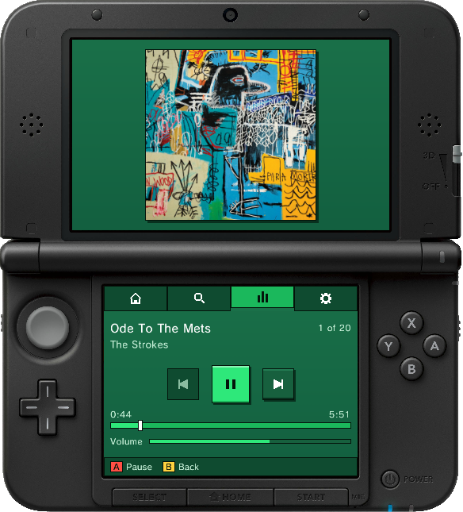
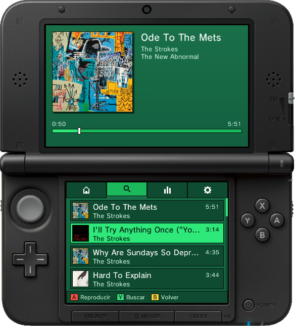

Nota: Esta documentación también está disponible en español: `README_es.md`

# 3DSpotify

Unofficial Spotify client for the Nintendo 3DS. The app connects directly to
Spotify over HTTPS.

> [!WARNING]
> **Spotify account compatibility**
>
> Spotify has changed how it delivers audio decryption keys. Some Premium
> accounts, apparently those created after a cutoff date, can no longer obtain
> the keys 3DSpotify needs. Sign-in and search still work, but every song fails
> with `Audio key refused (0x0001)`. The same accounts play normally in the
> official Spotify apps.
>
> This is a Spotify-side restriction, not a bug in 3DSpotify or a problem with
> your console or setup. It affects all librespot-based clients the same way;
> see [librespot#1649](https://github.com/librespot-org/librespot/issues/1649).
> No workaround is known yet. I am working on a fix, or at least an
> alternative for affected accounts.

<div style="display: flex; gap: 10px">
  
  
</div>

## Overview
This repository contains:
- The native 3DS client, with its entry point in `source/main.c` and UI modules in [source/ui](source/ui), which pairs the account on-console, searches for songs, artists, albums and playlists, and plays audio locally with album artwork.
- Independent protocol probes and build/test tooling in `source` and `tests`.

## Requirements
- Spotify **Premium** account.
- A Nintendo 3DS with Homebrew Launcher and Wi-Fi access.
- To build from source: devkitPro with devkitARM, libctru, citro2d, citro3d and 3dsxtool, plus Python 3.12 or newer.

Audio preparation exchanges OAuth for reusable AP credentials, then
authenticates a new AP connection before requesting the audio key, following
librespot's login flow. These AP credentials stay in memory and are never logged
or saved. A key refusal displays the server code; it does not by itself prove
that the account lacks Premium.

## Building the native client

Install devkitPro with devkitARM, libctru, citro2d, citro3d and 3dsxtool, plus
Python 3.12 or newer. From the repository root:

```powershell
python source\build.py --app 3dspotify --fetch-deps --debug
```

The default and only full-client target is `3dspotify`. Omit `--debug` for an
optimized release build. The pinned downloads
verify mbedTLS 3.6.7, `stb_vorbis` and `qrcodegen` 1.8.0 (the pairing QR code);
the Vorbis header is generated from that same verified source.
Once dependencies have been downloaded, builds can omit `--fetch-deps`.

Run the build and integration tests from the repository root with:

```powershell
python -m unittest discover -s tests
```

The C tests for search encoding, queue boundaries, and cancellation run when a
host C compiler is available; otherwise unittest reports them as skipped.

The artifact is written to
`source\dist\3ds\3DSpotify\3DSpotify.3dsx`. Copy it to
`SD:/3ds/3DSpotify/` and launch it from the Homebrew Launcher, or send it
from the PC with:

```powershell
3dslink.exe source\dist\3ds\3DSpotify\3DSpotify.3dsx -a <CONSOLE_IP>
```
`3dslink` is part of devkitPro's tools.

To install it on the Home Menu instead, build the CIA as well (needs
`makerom` and `bannertool`, both part of devkitPro's tools):

```powershell
python source\build.py --cia
```

This writes `source\dist\3ds\3DSpotify\3DSpotify.cia`; copy it to the SD
card and install it with FBI or a similar CIA installer (requires custom
firmware). The app creates `SD:/3ds/3DSpotify/` if needed and keeps its
settings and local data there.

Both the `.3dsx` and the `.cia` pack the repository's `romfs/` directory,
which the app reads as `romfs:/`; the build stops if it is missing. It holds
the logo of the top screen, `romfs/gfx/logo.png`:

- your own artwork, with no Spotify name or logo;
- an 8-bit RGBA PNG of at most 256×128 px, drawn 1:1 without scaling (a
  larger image is not loaded); its alpha channel is kept, soft edges
  included.

Without a usable logo the top screen shows the app name as text instead.

The target starts a direct session: it refreshes the stored credential, offers
pairing when needed, and checks the access-point and library-session
connections. The refresh token is saved to the SD card for later launches.

### Signing in

While it connects, the top screen shows the logo and a spinner, and the bottom
screen shows the current step ("Step n of N"). **SELECT** switches the language
on every sign-in screen.

If no credential is stored, or it has expired, the console asks you to link the
account:

- **Type the code:** open `spotify.com/pair` on a phone or computer, log in,
  enter the code shown on the top screen and accept.
- **Or scan the QR code** on the bottom screen: it opens the same page with the
  code already filled in.
- **B** cancels pairing and leaves the stored credential untouched.

If the session cannot start, the bottom screen explains why:

- **A** (or the **Retry** button) tries again with the stored credential. **A**
  presses whichever button has the focus; left/right moves the focus.
- **Y** (or the **Pair** button) pairs again with a new code.
- **START** exits.

Without a network (Wi-Fi off, or the console's network or TLS setup failing),
only **START** and **SELECT** remain.

### Tabs

Once the session is up, the top of the bottom screen is a bar of four tabs, each shown by its
icon:

| Icon | Tab | What it holds |
|---|---|---|
| House | **Home** | Your recent playlists, your downloads, and a shortcut to search. |
| Magnifying glass | **Search** | The latest results, the search in progress, or its error. |
| Equalizer | **Playing** | The current track and its controls. |
| Gear | **Settings** | Language, downloads, reconnect and pair another account. |

- Tap a tab to open it (it switches when you lift the stylus inside it).
- **L/R** move to the previous or next tab from any screen; **ZL/ZR** (New 3DS only) do the
  same.
- Music keeps playing on every tab, and a search runs in the background while you move
  between them.
- **SELECT** switches the language from any tab and **START** exits.

### Top screen

- With nothing playing, or after a playback error, every tab shows the logo.
- While a track loads, plays (paused too) or has just finished, **Home**,
  **Search** and **Settings** show the now-playing card: cover, title, artist,
  album, the time and the progress bar with the download ahead of it. The
  **Playing** tab shows the cover large instead.
- While a search runs, the **Search** tab adds a floating "Searching…" bubble
  with the loading indicator over the logo or the card.
- With a detail open ([Details](#details)), the top screen shows its card instead:
  the cover or portrait, the name and up to four lines (artist, album, length and
  track number, year, label…; an artist's monthly listeners and the start of their biography). A line too long to fit scrolls sideways so it can be
  read in full.
- With search results on screen, the **Search** tab shows a strip of the result
  types with how many of each were found, the one on screen highlighted, and below it
  the card of the highlighted result (its cover or portrait arrives once you stop on it
  for a moment).
- With a detail, a preview or the downloads manager on the top screen, if something is
  playing, a mini player in the bottom right corner shows the cover, the title, the
  artist, whether it is paused and the progress; while a track loads, the loading
  spinner turns in it instead of in the middle of the screen. An artist's whole
  biography, a page to read, has none. It is not a control: pause and skip on the
  **Playing** tab.

### Home

The tab shows your six most recently played playlists as tiles (cover and name, in two
columns), loaded in the background while skeleton tiles show. The ones you played last come
first, then the rest of your playlist folder. If the account has no play history, the label
reads **"Your playlists"** and the folder keeps its own order. Spotify's DJ is left out: it
is a live session of another service, with no track list this client can play.

- The first tile is always **Liked Songs** (a heart where the cover goes), newest first,
  loaded 50 at a time like a playlist.
- The second tile is always **Downloads** ([Downloads](#downloads)).
- With a tile highlighted, the top screen previews it: cover, name, number of tracks and
  the last song played in it. The cover loads once the highlight rests for a moment.
- Playlists always open at their first song; the last song played is only shown on the
  preview (often it is not even in the playlist: autoplay goes on past the end).
- Move between tiles with the D-pad; down from the last row reaches **"Show more"**, which
  lists up to 24 playlists in a scrolling grid. **B** goes back to the six.
- Tap a tile to highlight it; tap it again (or press **A**) to open the playlist
  ([Details](#details)).
- If loading fails, press **A** (or tap **"Retry"**). An account with no playlists gets a
  **"Search songs"** button instead.

**Button hints:**
- <span style="background-color: #FF4F45; color: white; padding: 2px 4px; border-radius: 2px;">A</span> — opens the highlighted playlist
- <span style="background-color: #39D97A; color: black; padding: 2px 4px; border-radius: 2px;">Y</span> — opens the search keyboard; once confirmed, the app moves to the **Search** tab
- <span style="background-color: #FFD23F; color: black; padding: 2px 4px; border-radius: 2px;">B</span> — in "Show more", back to the six

Covers that Spotify generates itself (mixes, blends, the DJ) are not on the CDN this client
reaches, so those tiles keep the note placeholder. Names with emoji show the characters the
console's font lacks as boxes.

While the keyboard is open, the playing track pauses; it resumes once the keyboard closes.

### Search

A search finds songs, artists, albums and playlists. Results show one type at a time, four rows on screen, and start on the type of Spotify's top result (an artist for "the killers", an album for "ok computer"). The **bottom screen** shows the list with thumbnails under the tab bar; the top screen follows [Top screen](#top-screen).

**Navigation:**
- Use up/down to move through the list; the highlighted row gets a brighter green background.
- Press left/right to switch between Songs, Artists, Albums and Playlists. Types with nothing found are skipped, and each type keeps its place when you come back to it.
- Tap a row to highlight it; tap it again (or press **A**) to open it: a song plays (the app moves to the **Playing** tab); an artist, album or playlist opens its detail ([Details](#details)).
- Drag the list with the stylus to scroll; the bar on the right edge shows your position.

**Button hints:**
- <span style="background-color: #FF4F45; color: white; padding: 2px 4px; border-radius: 2px;">A</span> — plays the highlighted song, or opens the highlighted artist, album or playlist
- <span style="background-color: #FFD23F; color: black; padding: 2px 4px; border-radius: 2px;">B</span> — back to the screen before the search (from there, to the Home tab)
- <span style="background-color: #3FA2FF; color: black; padding: 2px 4px; border-radius: 2px;">X</span> — opens the highlighted song's detail ([Details](#details)); songs only
- <span style="background-color: #39D97A; color: black; padding: 2px 4px; border-radius: 2px;">Y</span> — enters a new search
- Left/right — switches the type of results

Searching by type uses the service Spotify's web player searches with. If it stops answering, the app searches the way it always did: songs, plus the artists and albums of those songs, and no playlists.

**Touch gestures:**
- **Tap a row:** selects the song; the row highlights.
- **Tap again:** plays it immediately, followed by a radio of similar songs.
- **Drag vertically:** scrolls the list; rows can be cut off by the tab bar and the button bar.
- **Drag beyond 8 pixels from the starting point:** commits to scrolling; the row tap is cancelled.

**Search status:**
- Before the first search, the tab offers a **"Search songs"** button, and below it your last three searches to repeat.
- If the search fails, press **A** (or tap the on-screen button) to retry.
- Press **B** to cancel a pending search after the current network request finishes.

### Playing

The chosen track plays locally and keeps playing when you switch tabs. When it ends, the next one in the queue starts by itself.
- The **top screen** shows the album artwork large (a note placeholder until it arrives).
- The **bottom screen** shows the title, artist, album and place in the queue ("3 of 24"), the previous, play/pause and next buttons, the time, the progress bar (with the download ahead of it) and the volume bar.
- Tap the **title**, the **artist** or the **album** to open its detail ([Details](#details)). They work while the track loads, plays or has finished; the text turns lime with an underline while pressed.
- The icon to the right of the artist and album says whether the track is on the SD card: an arrow
  (not downloaded), a clock (queued), its percentage (downloading) or a check (downloaded).
  Tap the arrow, or press
  <span style="background-color: #3FA2FF; color: black; padding: 2px 4px; border-radius: 2px;">X</span>,
  to download the track.

**Playback controls:**
- <span style="background-color: #FF4F45; color: white; padding: 2px 4px; border-radius: 2px;">A</span> — pauses/resumes; once the track has finished, plays it again; after an error, retries
- Left/right, or the on-screen buttons — changes track
- Up/down — adjusts local volume
- **Touch the volume bar** — sets the volume; drag to adjust it
- **Drag the progress bar** — the handle and the time follow; the track jumps there when you
  lift the stylus. Only once the whole track is downloaded (the download layer of the bar is
  full).
- <span style="background-color: #FFD23F; color: black; padding: 2px 4px; border-radius: 2px;">B</span> — returns to the Search tab without stopping the music
- **START** — stops and exits

**The queue** depends on where you picked the song:
- **A single song** (a search result, or its detail): the song and 25 recommendations of
  similar songs, which arrive in the background once it plays. When 2 are left, 25 more
  come, without repeats, so the radio never runs out.
- **An album, artist or playlist:** the list from the chosen song, in order or shuffled
  (<span style="background-color: #39D97A; color: black; padding: 2px 4px; border-radius: 2px;">Y</span>
  in the list, see [Details](#details)). A playlist keeps loading the pages its detail had
  not loaded yet, up to 500 songs. Playback stops at the end of the list.

The queue does not wrap at either end: there, the previous or next button shows as disabled. Complete playback, artwork,
and controls still need validation on real hardware. The probes remain available as separate targets.

### Details

From a song you can open its detail, and from there its artist and album:

- **Song:** **Play**, **Download**, **Artist: …** and **Album: …** buttons (up/down and
  **A**, or tap). Play starts the song with the list it came from as the queue; for a song
  from the search results, or from the radio playing, a radio from it. The download button
  shows where the song is: **Download**, **Queued**, **Downloading 42%**, **Retry
  download**, **Remove download** (press **A** twice) or **Downloaded** when it came with an
  album or playlist (remove it with them).
- **Album and playlist:** a **Download album** / **Download playlist** button above the
  list downloads them whole; up from the first song reaches it. It then shows the progress
  ("Downloading 8 of 12") and **Downloaded**, which opens the downloaded copy.
- **Album:** its tracks, numbered. **Artist:** popular tracks, then their discography
  (albums, singles and EPs, compilations); A on a release opens the album. The button
  on the "Popular tracks" header shows the whole biography on the top screen, to scroll
  with the D-pad.
  **Playlist:** its tracks, with thumbnails, loaded 50 at a time: the next page comes by
  itself as you near the end of the list (a "Loading…" bubble shows meanwhile), up to 500.
  Episodes and local files are left out; the top screen says how many of how many are
  loaded.
  **A** (or tapping the highlighted row) plays from that song with the list as the
  queue; <span style="background-color: #3FA2FF; color: black; padding: 2px 4px; border-radius: 2px;">X</span> opens the song's detail;
  <span style="background-color: #39D97A; color: black; padding: 2px 4px; border-radius: 2px;">Y</span>
  switches shuffle on or off. Shuffle is one setting for every list and is remembered
  between sessions; the button bar shows it ("Shuffle" or "In order"). Shuffled, the
  chosen song plays first and the rest follow in random order. Switching it while a list
  plays reorders the queue at once, without cutting the song.
- **B** goes back one level; with no detail left, it does what it always does on that
  tab. **L/R** change tab and keep each tab's details where you left them.
- Album, artist and playlist details load in the background: **B** cancels, and if
  loading fails **A** retries.

Details open from **Home** (a playlist tile), from **Search** (<span style="background-color: #3FA2FF; color: black; padding: 2px 4px; border-radius: 2px;">X</span> on a song, <span style="background-color: #FF4F45; color: white; padding: 2px 4px; border-radius: 2px;">A</span> on an artist, album or playlist) and from
**Playing** (tap the title, artist or album). A new search closes the details open in
**Search**.

### Downloads

Songs, albums and playlists (Liked Songs too) can be saved to the SD card and played
without a connection.

- **Downloading:** the **Download** button in a song's, album's or playlist's detail, or
  <span style="background-color: #3FA2FF; color: black; padding: 2px 4px; border-radius: 2px;">X</span>
  on the **Playing** tab. Downloads run in the background, one song at a time, while you
  keep listening; they wait while the player loads a track.
- **Pace:** Spotify limits how many audio keys an account can ask for: about 15 in a row,
  then one every 30 seconds. A large playlist therefore takes a while; the queue waits and
  goes on by itself, and always leaves keys for the music you play.
- **Playing:** a downloaded song plays from the SD card wherever you pick it, with no
  network use for its audio.
- **Home → Downloads:** your downloaded albums and playlists, then the loose songs, most
  recent first. Open an album or playlist to play it; songs not yet downloaded are dimmed
  and skipped. Its **Remove download** button (press **A** twice) deletes it.
- **Settings → Downloads** (the manager): every download by state (downloading, queued,
  failed, downloaded), with the space used and free on the SD card.
  - <span style="background-color: #FF4F45; color: white; padding: 2px 4px; border-radius: 2px;">A</span>
    cancels a queued or running download, retries a failed one, or opens a downloaded one.
  - <span style="background-color: #3FA2FF; color: black; padding: 2px 4px; border-radius: 2px;">X</span>
    removes the highlighted row.
  - Cancelling and removing ask for a second press of the same button.
  - <span style="background-color: #39D97A; color: black; padding: 2px 4px; border-radius: 2px;">Y</span>
    pauses or resumes the whole queue.
- **Where they are:** in `SD:/3ds/3DSpotify/downloads/`. The audio stays encrypted as
  Spotify sends it, and its keys are stored encrypted with a key tied to this console: the
  files cannot be played on another console or by another program, and copying them
  elsewhere is no use. They belong to the account that downloaded them; after pairing a
  different account they are not shown.

**Offline:** with a stored credential, the app starts without a connection, at once when
Wi-Fi is off, or when Spotify cannot be reached. It also switches to offline by itself if
Wi-Fi goes while you use it, without stopping what plays from the SD card.

- A crossed-out Wi-Fi icon shows beside the **Search** tab icon.
- **Home** shows only the **Downloads** tile, and **Search** says it needs a connection.
- Only downloaded songs play: skipping onto one that is not on the SD card jumps to the next
  downloaded one. Artist and album links, and new downloads, are unavailable; queued
  downloads wait for the connection.
- **Retry connection** (Home), **Retry** (Search) or **Reconnect** (Settings) connect
  without leaving the app; the music keeps playing. If Spotify rejects the account, the
  sign-in starts again as at launch.

### Settings

- **Language** — shows the current language and switches it (so does **SELECT** from any tab).
- **Downloads** — opens the downloads manager ([Downloads](#downloads)); it shows how many
  are waiting.
- **Reconnect** — opens the session again with the saved credential.
- **Pair another account** — starts pairing with a new code.

Choose with up/down and **A**, or by tapping the button. Reconnecting while online and pairing stop playback. **B** returns to the Home tab.

## Probes

The probes are small standalone apps, each testing one step of the client on
its own. They were used to build it up piece by piece and are still handy for
diagnosing problems on real hardware. Run them one after another in the order
below: each step builds on the previous ones (for example, the later probes use
the token that `probe_pair` stores), so the first one that fails points to the
problem.

| Target | What it checks |
|---|---|
| `probe_tls` | TLS 1.2 handshakes and an HTTPS request against Spotify's hosts, with timings. Writes `spotify-tls.log` beside the `.3dsx`. |
| `probe_pair` | Pairing the console through spotify.com/pair and storing the token on the SD card. |
| `probe_ap` | Logging in to Spotify's access point and keeping the session alive. |
| `probe_meta` | The full sign-in chain, then reading the library and a track's metadata. |
| `probe_audio` | Decoding Ogg Vorbis and playing it through NDSP (reads `test.ogg`; no network). |
| `probe_play` | One track end to end: every audio file it offers, audio key, download, decryption and playback. Reads the track from `spotify-play-uri.txt` (a URI or share link) next to the `.3dsx` when present. |
| `probe_search` | Search by type through the service Spotify's web player uses: finding its query hash on open.spotify.com, the headers it accepts, the shape and timing of every kind of result, a stale hash, and today's search for comparison. Writes `probe_search.log` and the replies (`probe_search_*.json`, with the username blotted out) beside the `.3dsx`. |
| `probe_artist` | What an artist's metadata carries for its detail view: size and fields of the reply, the biography, the albums, singles and compilations with their names, dates and order, and two candidate sources of monthly listeners with their timings. Reads up to three more artists from `probe_artist.txt` (an id, URI or link per line). Writes `probe_artist.log` and the replies (`probe_artist_*.json`, `probe_artist_1_metadata.bin`, with the username blotted out) beside the `.3dsx`. |

Build one with `--app`, for example:

```powershell
python source\build.py --app probe_tls --fetch-deps
```

The output goes to `source/dist/3ds/<target>/`; copy that folder to
`SD:/3ds/<target>/` and launch it from the Homebrew Launcher.

## License and credits
- License: Apache License 2.0 — see the `LICENSE` file at the repository root.
- Author: David Abejón.
- Based on [SpotiBacan](https://github.com/ohquebacan/spotibacan) by
  [ohquebacan](https://github.com/ohquebacan). The `source/platform3ds/`
  directory, the `source/probe_*/` directories and `source/build.py` come from
  that project and have since been modified for 3DSpotify. See `NOTICE`.
- Included libraries: stbi (stb_image) at `include/stb_image.h` and other dependencies pinned by the native build.