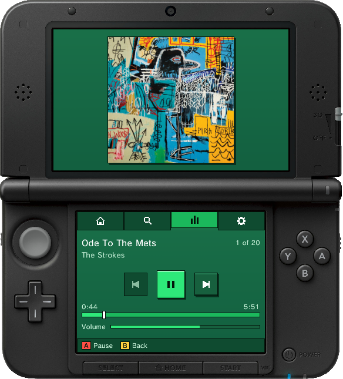
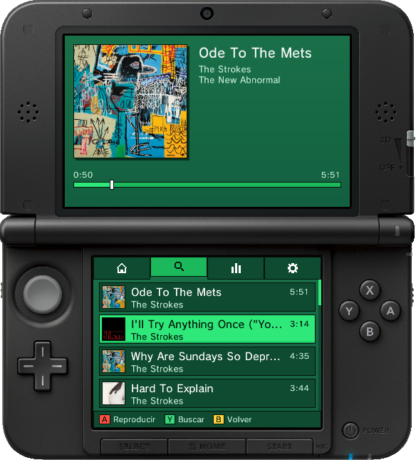

# 3DSpotify

Cliente no oficial de Spotify para Nintendo 3DS. La aplicación se conecta
directamente a Spotify por HTTPS.

> [!WARNING]
> **Compatibilidad de cuentas de Spotify**
>
> Spotify ha cambiado la forma en que entrega las claves para descifrar el
> audio. Algunas cuentas Premium, al parecer las creadas a partir de cierta
> fecha, ya no pueden obtener las claves que necesita 3DSpotify. El inicio de
> sesión y la búsqueda siguen funcionando, pero todas las canciones fallan con
> `Audio key refused (0x0001)`. Esas mismas cuentas funcionan con normalidad en
> las apps oficiales de Spotify.
>
> Es una restricción de Spotify, no un fallo de 3DSpotify ni un problema de tu
> consola o tu configuración. Afecta igual a todos los clientes basados en
> librespot; consulta
> [librespot#1649](https://github.com/librespot-org/librespot/issues/1649).
> Todavía no se conoce ninguna solución. Estoy trabajando para solucionarlo
> o, al menos, encontrar una alternativa para las cuentas afectadas.

<div style="display: flex; gap: 10px">
  
  
</div>

## Resumen
Este repositorio contiene:
- El cliente nativo para 3DS, con el punto de entrada en `source/main.c` y los módulos de interfaz en [source/ui](source/ui), que empareja la cuenta desde la consola, busca canciones, artistas, álbumes y playlists, y reproduce audio local con carátula.
- Probes independientes de protocolo y herramientas de build/tests en `source` y `tests`.

## Requisitos
- Cuenta de Spotify **Premium**.
- Una Nintendo 3DS con Homebrew Launcher y conexión Wi-Fi.
- Para compilar desde código: devkitPro con devkitARM, libctru, citro2d, citro3d y 3dsxtool, además de Python 3.12 o posterior.

La preparación de audio intercambia OAuth por credenciales reutilizables del AP
y autentica una nueva conexión antes de pedir la clave, siguiendo el flujo de
librespot. Estas credenciales AP quedan en memoria: no se guardan ni se registran.
El rechazo muestra el código del servidor, que por sí solo no demuestra que
falte Premium.

## Compilar el cliente nativo

Instala devkitPro con devkitARM, libctru, citro2d, citro3d y 3dsxtool, además
de Python 3.12 o posterior. Desde la raíz del repositorio:

```powershell
python source\build.py --app 3dspotify --fetch-deps --debug
```

El target predeterminado y único cliente completo es `3dspotify`. Omite
`--debug` para generar una versión optimizada. La descarga
fija y verifica mbedTLS 3.6.7, `stb_vorbis` y `qrcodegen` 1.8.0 (el código QR
del emparejamiento); también genera la cabecera de
Vorbis desde esa misma fuente verificada. Tras descargar las dependencias, se
puede compilar sin `--fetch-deps`.

Las pruebas de build e integración se ejecutan desde la raíz con:

```powershell
python -m unittest discover -s tests
```

La prueba C de codificación, cola y cancelación se ejecuta si hay un compilador
C nativo disponible; en caso contrario, unittest la marca como omitida.

El artefacto queda en
`source\dist\3ds\3DSpotify\3DSpotify.3dsx`. Cópialo a
`SD:/3ds/3DSpotify/` y ejecútalo desde Homebrew Launcher, o envíalo desde el
PC con:

```powershell
3dslink.exe source\dist\3ds\3DSpotify\3DSpotify.3dsx -a <IP_DE_LA_CONSOLA>
```
`3dslink` forma parte de las herramientas de devkitPro.

Para instalarla en el menú HOME, genera también el CIA (requiere `makerom` y
`bannertool`, incluidos en las herramientas de devkitPro):

```powershell
python source\build.py --cia
```

Se genera `source\dist\3ds\3DSpotify\3DSpotify.cia`; cópialo a la SD e
instálalo con FBI o un instalador de CIA similar (requiere custom firmware).
La app crea `SD:/3ds/3DSpotify/` si hace falta y guarda allí su configuración
y sus datos locales.

Tanto el `.3dsx` como el `.cia` empaquetan el directorio `romfs/` del
repositorio, que la app lee como `romfs:/`; si falta, el build se detiene.
Contiene el logo de la pantalla superior, `romfs/gfx/logo.png`:

- un diseño propio, sin el nombre ni el logo de Spotify;
- un PNG RGBA de 8 bits de 256×128 px como máximo, que se dibuja 1:1 sin
  reescalar (una imagen mayor no se carga); conserva su canal alfa, bordes
  suaves incluidos.

Sin un logo válido, la pantalla superior muestra el nombre de la app como
texto.

El target inicia la sesión directa: renueva la credencial guardada, permite
emparejar si hace falta y comprueba la conexión al access point y a la sesión
de biblioteca. El refresh token se guarda en la SD para los siguientes
arranques.

### Inicio de sesión

Mientras conecta, la pantalla superior muestra el logo y un spinner, y la
inferior el paso actual («Paso n de N»). **SELECT** cambia el idioma en todas
las pantallas de inicio de sesión.

Si no hay una credencial guardada, o ha caducado, la consola pide vincular la
cuenta:

- **Escribe el código:** abre `spotify.com/pair` en el móvil o el ordenador,
  inicia sesión, escribe el código de la pantalla superior y acepta.
- **O escanea el código QR** de la pantalla inferior: abre la misma página con
  el código ya escrito.
- **B** cancela el emparejamiento sin tocar la credencial guardada.

Si la sesión no puede iniciarse, la pantalla inferior explica por qué:

- **A** (o el botón **Reintentar**) vuelve a intentarlo con la credencial
  guardada. **A** pulsa el botón que tenga el foco; izquierda/derecha lo mueve.
- **Y** (o el botón **Emparejar**) empareja de nuevo con un código nuevo.
- **START** sale.

Sin red (Wi-Fi apagado, o un fallo al preparar la red o TLS de la consola),
solo quedan **START** y **SELECT**.

### Pestañas

Una vez iniciada la sesión, la parte superior de la pantalla inferior es una barra con cuatro
pestañas, cada una con su icono:

| Icono | Pestaña | Qué contiene |
|---|---|---|
| Casa | **Inicio** | Tus playlists recientes, tus descargas y un atajo a la búsqueda. |
| Lupa | **Búsqueda** | Los últimos resultados, la búsqueda en curso o su error. |
| Ecualizador | **Reproducción** | La canción que suena, con sus controles. |
| Engranaje | **Ajustes** | Idioma, descargas, volver a conectar y emparejar otra cuenta. |

- Toca una pestaña para abrirla (se activa al levantar el lápiz dentro de ella).
- **L/R** pasan a la pestaña anterior o siguiente desde cualquier pantalla; **ZL/ZR** (solo
  New 3DS) hacen lo mismo.
- La música sigue sonando en cualquier pestaña, y la búsqueda corre en segundo plano mientras
  te mueves entre ellas.
- **SELECT** cambia el idioma desde cualquier pestaña y **START** sale.

### Pantalla superior

- Sin nada sonando, o tras un error de reproducción, todas las pestañas
  muestran el logo.
- Mientras una pista carga, suena (también en pausa) o acaba de terminar,
  **Inicio**, **Búsqueda** y **Ajustes** muestran la ficha de lo que suena:
  carátula, título, artista, álbum, el tiempo y la barra de progreso con la
  descarga por delante. La pestaña **Reproducción** muestra la carátula en
  grande.
- Mientras hay una búsqueda en curso, la pestaña **Búsqueda** añade encima
  del logo o de la ficha una burbuja flotante «Buscando…» con el indicador de
  carga.
- Con un detalle abierto ([Detalles](#detalles)), la pantalla superior muestra su
  ficha: la carátula o el retrato, el nombre y hasta cuatro líneas (artista, álbum,
  duración y número de pista, año, sello…; los oyentes mensuales de un artista y el principio de su biografía). Una línea demasiado larga se desplaza de
  lado para poder leerla entera.
- Con resultados de búsqueda en pantalla, la pestaña **Búsqueda** muestra una franja
  con los tipos de resultado y cuántos hay de cada uno, con el que está en pantalla
  resaltado, y debajo la ficha del resultado resaltado (su portada o retrato llega
  cuando te paras un momento en él).

### Inicio

La pestaña muestra tus seis playlists reproducidas más recientemente como teselas (portada y
nombre, en dos columnas), que se cargan en segundo plano mientras se ven teselas de espera.
Primero van las que escuchaste por última vez y después el resto de tu carpeta de playlists.
Si la cuenta no tiene historial, la etiqueta dice **«Tus playlists»** y la carpeta conserva su
propio orden. El DJ de Spotify no aparece: es una sesión en vivo de otro servicio, sin lista
de canciones que este cliente pueda reproducir.

- La primera tesela es siempre **Canciones que te gustan** (un corazón donde iría la
  portada), de la más reciente a la más antigua, cargadas de 50 en 50 como una playlist.
- La segunda tesela es siempre **Descargas** ([Descargas](#descargas)).
- Con una tesela resaltada, la pantalla superior muestra una vista previa: portada,
  nombre, número de canciones y lo último que sonó en ella. La portada se carga cuando el
  resaltado se queda quieto un momento.
- Las playlists se abren siempre por su primera canción; lo último que sonó solo se
  muestra en la vista previa (a menudo ni siquiera está en la playlist: la reproducción
  automática sigue después del final).
- Muévete entre teselas con la cruceta; bajando desde la última fila llegas a **«Mostrar
  más»**, que lista hasta 24 playlists en una rejilla con desplazamiento. **B** vuelve a las
  seis.
- Toca una tesela para resaltarla; tócala otra vez (o pulsa **A**) para abrir la playlist
  ([Detalles](#detalles)).
- Si la carga falla, pulsa **A** (o toca **«Reintentar»**). Una cuenta sin playlists ofrece
  en su lugar el botón **«Buscar canciones»**.

**Indicadores de acción:**
- <span style="background-color: #FF4F45; color: white; padding: 2px 4px; border-radius: 2px;">A</span> — abre la playlist resaltada
- <span style="background-color: #39D97A; color: black; padding: 2px 4px; border-radius: 2px;">Y</span> — abre el teclado de búsqueda; al confirmar, la app pasa a la pestaña **Búsqueda**
- <span style="background-color: #FFD23F; color: black; padding: 2px 4px; border-radius: 2px;">B</span> — en «Mostrar más», vuelve a las seis

Las portadas que genera Spotify (mixes, blends, el DJ) no están en el CDN al que llega este
cliente, así que esas teselas se quedan con el marcador de la nota. En los nombres con emoji,
los caracteres que la fuente de la consola no tiene se ven como recuadros.

Mientras el teclado está abierto, la canción que suena se pausa y sigue al cerrarlo.

### Búsqueda

Una búsqueda encuentra canciones, artistas, álbumes y playlists. Los resultados muestran un tipo cada vez, cuatro filas en pantalla, y empiezan por el tipo del mejor resultado de Spotify (un artista para «the killers», un álbum para «ok computer»). La **pantalla inferior** muestra la lista con miniaturas bajo la barra de pestañas; la superior sigue lo descrito en [Pantalla superior](#pantalla-superior).

**Navegación:**
- Arriba/abajo recorre la lista; la fila resaltada gana un fondo verde más brillante.
- Izquierda/derecha cambia entre Canciones, Artistas, Álbumes y Playlists. Los tipos sin resultados se saltan, y cada tipo conserva por dónde ibas al volver a él.
- Toca una fila para resaltarla; tócala otra vez (o pulsa **A**) para abrirla: una canción se reproduce (la app pasa a la pestaña **Reproducción**); un artista, un álbum o una playlist abre su detalle ([Detalles](#detalles)).
- Arrastra la lista con el lápiz para desplazarla; la barra del borde derecho indica por dónde vas.

**Indicadores de acción:**
- <span style="background-color: #FF4F45; color: white; padding: 2px 4px; border-radius: 2px;">A</span> — reproduce la canción resaltada, o abre el artista, el álbum o la playlist resaltada
- <span style="background-color: #FFD23F; color: black; padding: 2px 4px; border-radius: 2px;">B</span> — vuelve a la pantalla de antes de buscar (y desde ella, a la pestaña Inicio)
- <span style="background-color: #3FA2FF; color: black; padding: 2px 4px; border-radius: 2px;">X</span> — abre el detalle de la canción resaltada ([Detalles](#detalles)); solo en canciones
- <span style="background-color: #39D97A; color: black; padding: 2px 4px; border-radius: 2px;">Y</span> — inicia una nueva búsqueda
- Izquierda/derecha — cambia el tipo de resultados

La búsqueda por tipos usa el servicio con el que busca el web player de Spotify. Si deja de responder, la app busca como siempre: canciones, más los artistas y álbumes de esas canciones, y sin playlists.

**Gestos táctiles:**
- **Tocar una fila:** selecciona la canción; la fila se resalta.
- **Tocar nuevamente:** reproduce la canción al momento, seguida de una radio de canciones parecidas.
- **Arrastrar verticalmente:** desplaza la lista; las filas pueden quedar cortadas por la barra de pestañas y la barra de botones.
- **Arrastrar más de 8 píxeles desde donde tocaste:** el arrastre se confirma; el toque de la fila se cancela.

**Estado de la búsqueda:**
- Antes de la primera búsqueda, la pestaña ofrece el botón **«Buscar canciones»** y, debajo, tus tres últimas búsquedas para repetirlas.
- Si la búsqueda falla, pulsa **A** (o toca el botón de la pantalla) para reintentar.
- Pulsa **B** para cancelar una búsqueda pendiente cuando termine la petición de red activa.

### Reproducción

La canción elegida se reproduce localmente y sigue sonando aunque cambies de pestaña. Al terminar, empieza sola la siguiente de la cola.
- La **pantalla superior** muestra la carátula en grande (con el marcador de la nota hasta que llega).
- La **pantalla inferior** muestra el título, el artista, el álbum y la posición en la cola («3 de 24»), los botones anterior, reproducir/pausa y siguiente, el tiempo, la barra de progreso (con lo descargado por delante) y la de volumen.
- Toca el **título**, el **artista** o el **álbum** para abrir su detalle ([Detalles](#detalles)). Funcionan mientras la pista carga, suena o ha terminado; al pulsarlos, el texto pasa a color lima y se subraya.
- El icono a la derecha del artista y el álbum dice si la canción está en la SD: una flecha
  (sin descargar), un reloj (en cola), su porcentaje (descargándose) o un check
  (descargada). Toca la flecha, o pulsa
  <span style="background-color: #3FA2FF; color: black; padding: 2px 4px; border-radius: 2px;">X</span>,
  para descargarla.

**Controles de reproducción:**
- <span style="background-color: #FF4F45; color: white; padding: 2px 4px; border-radius: 2px;">A</span> — pausa/reanuda; con la pista terminada, la vuelve a empezar; con un error, reintenta
- Izquierda/derecha, o los botones de la pantalla — cambia de pista
- Arriba/abajo — ajusta el volumen local
- **Tocar la barra de volumen** — fija el volumen; arrastra para ajustarlo
- **Arrastrar la barra de progreso** — el tirador y el tiempo siguen al dedo; la pista salta
  ahí al levantar el lápiz. Solo con la canción entera descargada (la capa de descarga de la
  barra llena).
- <span style="background-color: #FFD23F; color: black; padding: 2px 4px; border-radius: 2px;">B</span> — vuelve a la pestaña Búsqueda sin cortar la música
- **START** — detiene y sale

**La cola** depende de dónde eliges la canción:
- **Una canción suelta** (un resultado de búsqueda, o su detalle): la canción y 25
  recomendaciones de canciones parecidas, que llegan en segundo plano cuando ya suena.
  Cuando quedan 2, llegan 25 más, sin repetir, así que la radio no se acaba.
- **Un álbum, artista o playlist:** la lista desde la canción elegida, en orden o en
  aleatorio (<span style="background-color: #39D97A; color: black; padding: 2px 4px; border-radius: 2px;">Y</span>
  en la lista, ver [Detalles](#detalles)). Una playlist sigue cargando las páginas que su
  detalle aún no había cargado, hasta 500 canciones. Al acabar la lista, se para.

La cola no envuelve en sus extremos: en ellos, el botón anterior o siguiente aparece deshabilitado. La reproducción completa, carátulas y controles aún deben validarse en una 3DS real. Los probes siguen disponibles como targets independientes.

### Detalles

Desde una canción puedes abrir su detalle y, desde ahí, el de su artista y su álbum:

- **Canción:** botones **Reproducir**, **Descargar**, **Artista: …** y **Album: …**
  (arriba/abajo y **A**, o tocando). Reproducir empieza la canción con la lista de la que
  salió como cola; si es una canción de los resultados de búsqueda, o de la radio que
  suena, una radio a partir de ella. El botón de descarga dice dónde está la canción:
  **Descargar**, **En cola**, **Descargando 42%**, **Reintentar descarga**, **Borrar
  descarga** (pulsa **A** dos veces) o **Descargado** si llegó con un álbum o una playlist
  (se borra con ellos).
- **Álbum y playlist:** encima de la lista, el botón **Descargar álbum** / **Descargar
  playlist** los descarga enteros; se llega subiendo desde la primera canción. Después
  muestra el progreso («Descargando 8 de 12») y **Descargado**, que abre la copia
  descargada.
- **Álbum:** sus pistas, numeradas. **Artista:** sus canciones populares y, debajo, su
  discografía (álbumes, sencillos y EP, recopilatorios); A sobre un lanzamiento abre el
  álbum. El botón de la cabecera «Canciones populares» muestra la biografía entera en la
  pantalla superior, para desplazarla con la cruceta. **Playlist:** sus canciones, con miniaturas, de 50 en 50: la página
  siguiente llega sola al acercarte al final de la lista (mientras, se ve la burbuja
  «Cargando…»), hasta 500. Los episodios y archivos locales se omiten; la pantalla
  superior indica cuántas de cuántas hay cargadas.
  **A** (o tocar la fila resaltada) reproduce desde esa canción con la
  lista como cola; <span style="background-color: #3FA2FF; color: black; padding: 2px 4px; border-radius: 2px;">X</span> abre el detalle de la canción;
  <span style="background-color: #39D97A; color: black; padding: 2px 4px; border-radius: 2px;">Y</span>
  activa o desactiva el aleatorio. Es un solo ajuste para todas las listas y se recuerda
  entre sesiones; la barra de botones lo muestra («Aleatorio» o «En orden»). En aleatorio,
  la canción elegida suena primero y el resto le sigue en orden aleatorio. Cambiarlo
  mientras suena una lista reordena la cola al momento, sin cortar la canción.
- **B** vuelve un nivel atrás; sin detalles abiertos, hace lo de siempre en esa
  pestaña. **L/R** cambian de pestaña y conservan los detalles de cada una donde los
  dejaste.
- Los detalles de álbum, artista y playlist se cargan en segundo plano: **B** cancela
  y, si la carga falla, **A** reintenta.

Los detalles se abren desde **Inicio** (una tesela de playlist), desde **Búsqueda**
(<span style="background-color: #3FA2FF; color: black; padding: 2px 4px; border-radius: 2px;">X</span> sobre un resultado) y desde **Reproducción** (tocando el título, el artista o el
álbum). Una búsqueda nueva cierra los detalles abiertos en **Búsqueda**.

### Descargas

Las canciones, álbumes y playlists (también Canciones que te gustan) se pueden guardar en
la SD y escuchar sin conexión.

- **Descargar:** el botón **Descargar** en el detalle de una canción, un álbum o una
  playlist, o
  <span style="background-color: #3FA2FF; color: black; padding: 2px 4px; border-radius: 2px;">X</span>
  en la pestaña **Reproducción**. Las descargas van en segundo plano, una canción cada vez,
  mientras sigues escuchando; esperan mientras el reproductor carga una pista.
- **Ritmo:** Spotify limita cuántas claves de audio puede pedir una cuenta: unas 15
  seguidas y luego una cada 30 segundos. Por eso una playlist grande tarda un rato; la cola
  espera y sigue sola, y siempre deja claves para la música que pones.
- **Reproducir:** una canción descargada suena desde la SD la elijas donde la elijas, sin
  usar la red para su audio.
- **Inicio → Descargas:** tus álbumes y playlists descargados y después las canciones
  sueltas, lo más reciente primero. Abre un álbum o una playlist para reproducirlo; las
  canciones que aún no están descargadas salen atenuadas y se saltan. Su botón **Borrar
  descarga** (pulsa **A** dos veces) lo borra.
- **Ajustes → Descargas** (el gestor): todas las descargas por estado (en curso, en cola,
  con error, descargadas), con el espacio ocupado y el libre en la SD.
  - <span style="background-color: #FF4F45; color: white; padding: 2px 4px; border-radius: 2px;">A</span>
    cancela una descarga en cola o en curso, reintenta una con error o abre una descargada.
  - <span style="background-color: #3FA2FF; color: black; padding: 2px 4px; border-radius: 2px;">X</span>
    borra la fila resaltada.
  - Cancelar y borrar piden una segunda pulsación del mismo botón.
  - <span style="background-color: #39D97A; color: black; padding: 2px 4px; border-radius: 2px;">Y</span>
    pausa o reanuda toda la cola.
- **Dónde están:** en `SD:/3ds/3DSpotify/downloads/`. El audio sigue cifrado tal como lo
  envía Spotify, y sus claves se guardan cifradas con una clave ligada a esta consola: los
  archivos no se pueden reproducir en otra consola ni con otro programa, y copiarlos a otro
  sitio no sirve de nada. Son de la cuenta que los descargó; tras emparejar otra cuenta no
  se muestran.

**Sin conexión:** con una credencial guardada, la app arranca sin conexión: al momento si
el Wi-Fi está apagado, o cuando no llega a Spotify. También pasa sola a sin conexión si el
Wi-Fi se va mientras la usas, sin cortar lo que suena desde la SD.

- Junto al icono de la pestaña **Búsqueda** aparece un icono de Wi-Fi tachado.
- **Inicio** muestra solo la tesela **Descargas**, y **Búsqueda** avisa de que hace falta
  conexión.
- Solo suena lo descargado: al pasar a una canción que no está en la SD, salta a la
  siguiente descargada. Los enlaces de artista y álbum y las descargas nuevas no están
  disponibles; las descargas en cola esperan a la conexión.
- **Reintentar conexión** (Inicio), **Reintentar** (Búsqueda) o **Volver a conectar**
  (Ajustes) conectan sin salir de la app, y la música sigue sonando. Si Spotify rechaza la
  cuenta, el inicio de sesión empieza de nuevo como al abrir la app.

### Ajustes

- **Idioma** — muestra el idioma actual y lo cambia (también con **SELECT** desde cualquier pestaña).
- **Descargas** — abre el gestor de descargas ([Descargas](#descargas)); dice cuántas
  esperan.
- **Volver a conectar** — vuelve a abrir la sesión con la credencial guardada.
- **Emparejar otra cuenta** — empieza el emparejamiento con un código nuevo.

Elige con arriba/abajo y **A**, o tocando el botón. Volver a conectar con conexión y emparejar detienen la reproducción. **B** vuelve a la pestaña Inicio.

## Probes

Los probes son pequeñas aplicaciones independientes que prueban, cada una por
separado, un paso del cliente. Se usaron para construirlo pieza a pieza y
siguen siendo útiles para diagnosticar problemas en una 3DS real. Ejecútalos
uno después de otro en el orden de la tabla: cada paso se apoya en los
anteriores (por ejemplo, los últimos probes usan el token que guarda
`probe_pair`), así que el primero que falle indica dónde está el problema.

| Target | Qué comprueba |
|---|---|
| `probe_tls` | Handshakes TLS 1.2 y una petición HTTPS contra los servidores de Spotify, con tiempos. Escribe `spotify-tls.log` junto al `.3dsx`. |
| `probe_pair` | El emparejamiento de la consola mediante spotify.com/pair y el guardado del token en la SD. |
| `probe_ap` | El inicio de sesión en el access point de Spotify y el mantenimiento de la sesión. |
| `probe_meta` | La cadena completa de inicio de sesión y la lectura de la biblioteca y los metadatos de una canción. |
| `probe_audio` | La decodificación de Ogg Vorbis y su reproducción por NDSP (lee `test.ogg`; sin red). |
| `probe_play` | Una canción de principio a fin: clave de audio, descarga, descifrado y reproducción. |
| `probe_search` | La búsqueda por tipos mediante el servicio del web player de Spotify: cómo encontrar el hash de sus consultas en open.spotify.com, las cabeceras que acepta, la forma y los tiempos de cada tipo de resultado, un hash caducado, y la búsqueda de siempre para comparar. Escribe `probe_search.log` y las respuestas (`probe_search_*.json`, con el nombre de usuario tapado) junto al `.3dsx`. |
| `probe_artist` | Lo que traen los metadatos de un artista para su detalle: tamaño y campos de la respuesta, la biografía, los álbumes, sencillos y recopilatorios con sus nombres, fechas y orden, y dos posibles fuentes de oyentes mensuales con sus tiempos. Lee hasta tres artistas más de `probe_artist.txt` (un id, URI o enlace por línea). Escribe `probe_artist.log` y las respuestas (`probe_artist_*.json`, `probe_artist_1_metadata.bin`, con el nombre de usuario tapado) junto al `.3dsx`. |

Compila uno con `--app`, por ejemplo:

```powershell
python source\build.py --app probe_tls --fetch-deps
```

El resultado queda en `source/dist/3ds/<target>/`; copia esa carpeta a
`SD:/3ds/<target>/` y ábrelo desde Homebrew Launcher.

## Licencia y créditos
- Licencia: Apache License 2.0 — ver el archivo `LICENSE` en la raíz del repositorio.
- Autor: David Abejón.
- Basado en [SpotiBacan](https://github.com/ohquebacan/spotibacan), de
  [ohquebacan](https://github.com/ohquebacan). El directorio
  `source/platform3ds/`, los directorios `source/probe_*/` y `source/build.py`
  proceden de ese proyecto y se han modificado para 3DSpotify. Ver `NOTICE`.
- Librerías incluidas: stbi (stb_image) en `include/stb_image.h` y demás dependencias fijadas por el build nativo.